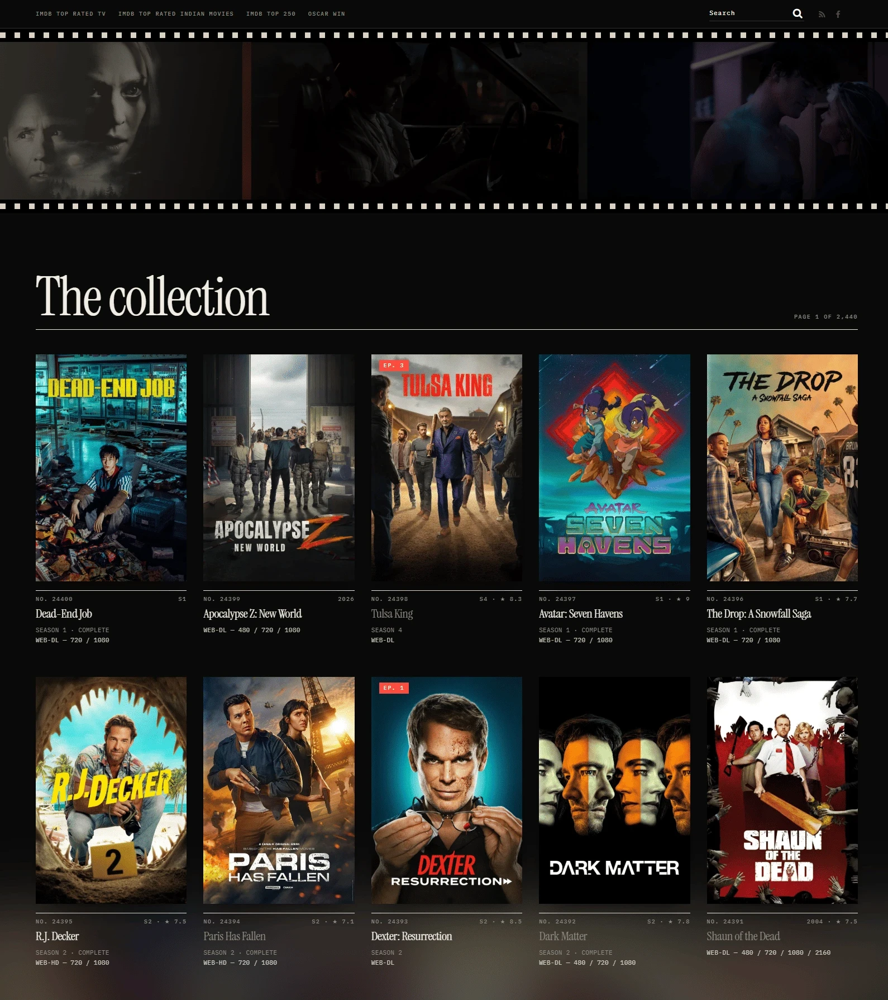
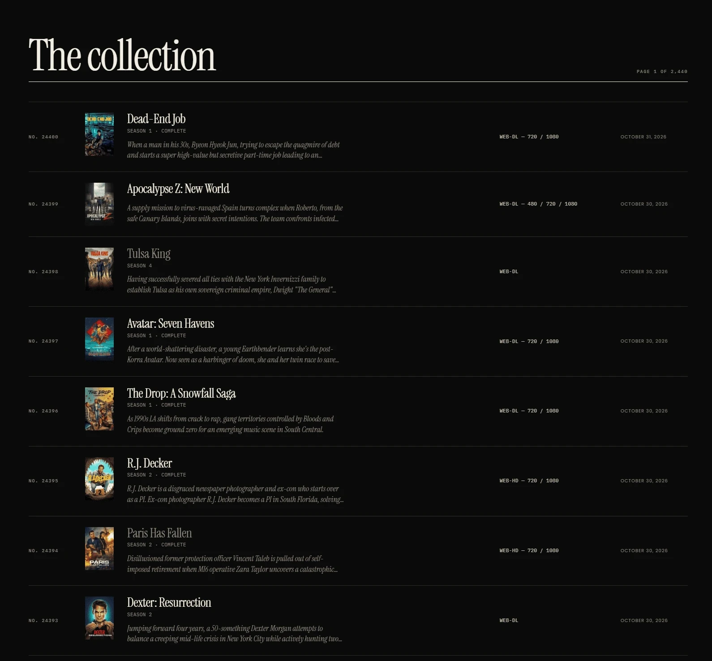
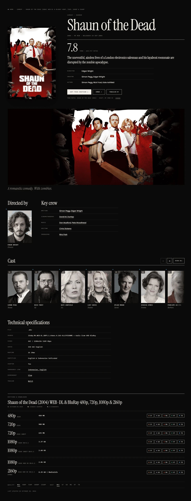
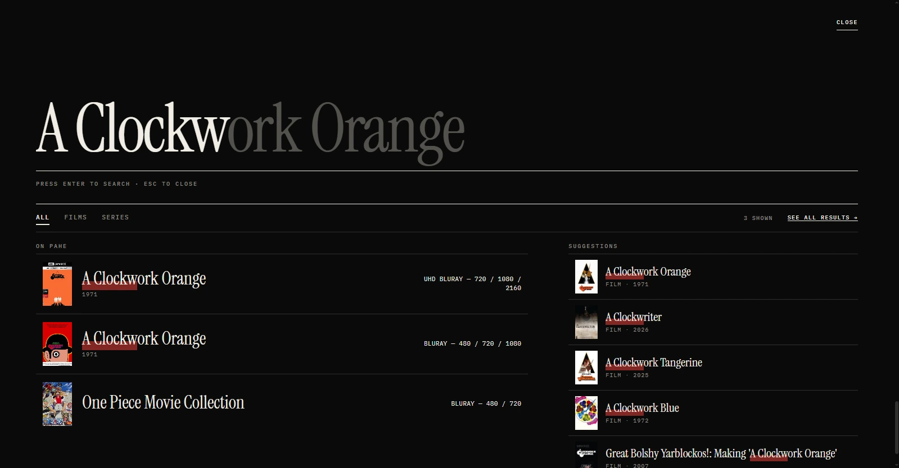
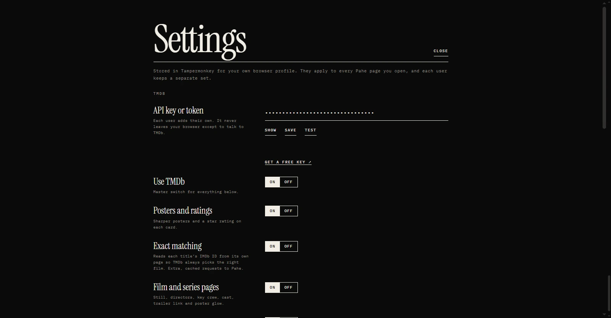

# Cinema UI for Pahe

A userscript that redesigns pahe.ink as a film catalogue in the spirit of the Criterion Collection and MUBI: large serif titles, hairline rules, spine numbers, a poster grid or a ledger list, rebuilt film and series pages, and full-screen search that suggests as you type. Optional TMDb data adds sharper posters, ratings, stills, directors, cast and a trailer link.

It changes how pages look and behave in your own browser. It does not touch the site's download links, does not skip anything the site does, and does not send your browsing anywhere except to the services listed under [Privacy](#privacy).

[Install from Greasy Fork](https://greasyfork.org/en/scripts/603043-cinema-ui-for-pahe) or [install from GitHub](https://raw.githubusercontent.com/insanebeggar/pahe-cinema-ui/main/pahe-cinema-ui.user.js)

## Contents

- [Screenshots](#screenshots)
- [Install](#install)
- [What it changes](#what-it-changes)
- [TMDb features](#tmdb-features)
- [Settings](#settings)
- [Keyboard shortcuts](#keyboard-shortcuts)
- [Privacy](#privacy)
- [Troubleshooting](#troubleshooting)
- [Adding other domains](#adding-other-domains)
- [Development](#development)
- [Changelog](#changelog)
- [Credits and licence](#credits-and-licence)

## Screenshots

| | |
|---|---|
|  |  |
| Poster grid, MUBI mood | Ledger with descriptions, Criterion mood |
|  |  |
| Film page with TMDb cast | Live search |
|  | |
| Settings panel | |

## Install

1. Install a userscript manager. Tampermonkey and Violentmonkey are the supported ones.
2. In Chrome or Edge, Tampermonkey 5.3 and later needs either the "Allow User Scripts" toggle (Chrome 138 and later) or Developer Mode turned on. Open the extension's details page from `chrome://extensions` and switch it on, then reload the site.
3. Open one of the install links above and confirm the install in your manager.
4. Visit pahe.ink. The page should restyle on load.

Greasemonkey 4 is not supported because the script uses the older `GM_` functions. Firefox users should use Tampermonkey or Violentmonkey.

Updates arrive through your userscript manager, usually within a day of a new version.

## What it changes

### Home pages, archives and search results

- Poster grid with 4, 5 or 6 columns on wide screens, stepping down on smaller ones.
- Each card shows a spine number, the year, the title in a serif face, the source (BluRay, WEB-DL) and the available resolutions. A red flag marks a new episode.
- Hovering a poster shows its synopsis. Titles you have already opened are greyed out.
- A ledger layout turns the grid into a ruled list with a small poster, the formats, the date and an optional description under each title.
- The row of new releases at the top becomes a film strip.
- Search results are grouped by month under large headings.

### Film and series pages

- A rebuilt header with a large poster, the title, genres, runtime, the IMDb rating, the synopsis and the credits from the original page. Runtime can show as minutes (125 min) or hours (2h 05m), and the same choice applies to the Runtime line in the specification table.
- A Letterboxd button next to the IMDb one. It uses the IMDb ID, so it lands on the right film page. Letterboxd lists films only, so series pages do not get it.
- The technical block (source, video, audio, subtitles) becomes a ruled specification table. The trailer and subtitle links inside it keep working.
- Download buttons are regrouped into rows by quality: resolution and codec on the left, file size in the middle, host buttons on the right. Your original buttons are moved, not replaced.
- Filters above the downloads let you pick one resolution or one host. The choice is remembered across pages.
- On series pages, episode tabs that appeared since your last visit get a red dot and a note.
- The previous and next links are arrows with a short title.
- Your last 14 film pages are listed under "Recently opened" in the index drawer.

### Lists

- A-Z lists get a sticky letter bar that highlights the letter you are on, a large letter marker for each section, titles split into name, year and formats, and a live filter box with a title count.
- Grid pages from the Other menu (for example the director and actor collections) use the same poster grid, with a filter box and the sort dropdown restyled.

### Header and navigation

- Three header styles. Cinema shows a slow wall of film images behind the wordmark. Plain shows only the wordmark. Original leaves the site's own header alone.
- Dropdown menus open under their own button, size to their longest entry, and flip sideways if they would leave the screen.
- A sticky navigation bar, with the theme's extra arrow marks removed.

### Colour and background

- Two moods: MUBI (near-black) and Criterion (warm paper).
- A contrast guard scans the page and corrects any text that would be unreadable against its background, in either mood.
- The site's own background picture can show through, along with a soft glow taken from the current poster or still. Dimming controls how strongly the page colour covers it.

### Search

Press `/` or use the Search button. The overlay is described in [Live search](#live-search).

### Index drawer

The sidebar widgets (recent, popular, comments, tags, archives, categories) move into a drawer that slides in from the right. It also holds the quick display settings.

## TMDb features

These are optional and need a free TMDb key. Without one, everything above still works.

Get a key at <https://www.themoviedb.org/settings/api>. Either the v3 API key or the v4 read access token works. Paste it into Settings, press Test, then Save and reload the page.

| Where | What it adds |
|---|---|
| Cards | A 500 px poster and a star rating next to the year |
| Film and series pages | A wide still with the tagline, directors (or creators for series) with photos, key crew, a cast carousel with a "View all" grid, a trailer button, a sharper poster and a soft glow from the backdrop |
| Header | Trending film stills, or the stills of the film you are viewing |
| Search | Name and title suggestions while you type |

Every person links to their TMDb page and opens in a new tab.

### Getting the right film

The script finds the TMDb entry in this order:

1. A match you chose yourself.
2. The IMDb ID. Film pages already link to IMDb, so the script reads that ID and asks TMDb for that exact title. With "Exact matching" on, listing cards read the ID from each title's own page too. These page fetches run two at a time and are cached.
3. The title, year, season and post date, scored against TMDb's search results. When several shows share a name and none fits the year, it shows nothing instead of guessing.

If a match is wrong, open the film page and press "Wrong match?" (or "Change") under the credits. Search TMDb, or paste a TMDb link or an IMDb ID, then pick the correct title. The choice is saved and also used on the listings. Settings > Data has "Clear manual matches".

### Live search

- Starts after two letters. Results come from the site's own search, with posters, year, formats and highlighted matches.
- A Films and Series switch filters the results.
- With TMDb on, suggested titles and names appear beside the results. The top suggestion shows as faint text inside the box and Tab accepts it.
- Choosing a person lists the titles they are known for.
- Recent searches appear when the box is empty.
- Arrow keys move through results, Enter opens one, Esc closes the overlay.

## Settings

Open the panel from the Tampermonkey menu entry "Pahe Cinema UI - Settings", or press `,` on any page. The index drawer has a shorter list of the display options.

Settings are stored by your userscript manager in your own browser profile. They apply to every page on the site, and each person using the script keeps their own set.

| Setting | Options | Default |
|---|---|---|
| Mood | MUBI, Criterion | MUBI |
| Header | Cinema, Plain, Original | Cinema |
| Layout | Posters, Ledger | Posters |
| Poster columns | 4, 5, 6 | 5 |
| Descriptions (ledger) | On, Off | On |
| Runtime | Minutes, Hours | Minutes |
| Letterboxd link | On, Off | On |
| Backdrop | Show, Hide | Show |
| Dimming | 50 to 100 percent | 80 |
| Live search | On, Off | On |
| Use TMDb | On, Off | On |
| TMDb key or token | text | empty |
| Posters and ratings | On, Off | On |
| Film and series pages | On, Off | On |
| Header stills | On, Off | On |
| Exact matching | On, Off | On |

Some TMDb changes need a page reload. The panel tells you when.

The Data section can clear the TMDb cache, clear history, export your settings, import them, and reset everything except your key. Exports leave the key out, so a settings file is safe to share.

### Tampermonkey menu entries

- Settings
- Switch MUBI and Criterion
- Turn TMDb on or off
- Clear TMDb cache

## Keyboard shortcuts

| Key | Action |
|---|---|
| `/` | Open search |
| `,` | Open settings |
| `i` | Open or close the index drawer |
| `t` | Switch mood |
| `v` | Switch between posters and ledger (listing pages) |
| `f` | Focus the filter box (list pages) |
| `j` and `k` | Move to the next or previous title |
| `Esc` | Close the open panel |

Shortcuts are ignored while you are typing in a field.

## Privacy

- Settings, caches, your recent pages and the list of episode tabs you have seen are stored locally by your userscript manager. Nothing is sent to the author. There are no analytics.
- With TMDb on, the script sends film titles, IMDb IDs and your own key to `api.themoviedb.org`, and loads images from `image.tmdb.org`.
- Fonts (Instrument Serif, Inter and IBM Plex Mono) load from Google Fonts. If that is blocked, the page falls back to Georgia and system fonts.
- Live search and "Exact matching" request pages from the site itself, in the same way your browser would when you open them.
- Trailer buttons are plain links. Nothing loads from YouTube until you click one.

## Troubleshooting

The page looks unchanged.
Check that the script is enabled in your manager. On Chrome or Edge, turn on "Allow User Scripts" or Developer Mode for the extension and reload. Make sure the extension has site access, and that the site's domain is covered by one of the `@match` lines.

TMDb data does not appear.
Add a key in Settings, press Test, Save, and reload. If Test fails with 401, the key is wrong. The first load of a page fills the cache, so some cards update a moment after the page shows.

A film shows the wrong poster or cast.
Use "Wrong match?" on the film page. For stale results elsewhere, clear the TMDb cache in Settings > Data.

Colours look wrong in one spot.
Switch mood with `t` and back. If the problem stays, open an issue with the page address and a screenshot.

Something broke after the site changed.
The script depends on the site's current page structure. Open an issue with the address of the page and, if you can, a saved copy of its HTML.

Another userscript or an ad blocker clashes with it.
Disable the other one on this site to confirm, then report both names.

## Adding other domains

The script runs on `pahe.ink` and `pahe.in`. If the site moves to a mirror, add the new address without editing the code: in Tampermonkey, open the script, go to the Settings tab and add an entry under "User matches". Violentmonkey has a similar custom match field. Editing the `@match` lines in the header also works, but an update will overwrite your change.

## Development

The whole script is one readable file, `pahe-cinema-ui.user.js`. It is not minified or bundled.

- A stylesheet applies to every rule with raised specificity and `!important`, so the theme's own dark-skin rules cannot win in either mood.
- JavaScript steps add structure around the original elements. Download buttons, tabs and forms are moved, not recreated, so the site's own handlers keep working.
- Each step runs inside its own error guard, so one failing part does not stop the others.
- Settings live in a single `DEFAULTS` object. Adding a setting means adding a default, a row in the settings panel and, if needed, a CSS variable or attribute set in `apply()`.

To work on it, install the script from a local file in your manager and enable "Allow access to file URLs" for the extension. Raise `@version` for every release so installed copies update.

Pull requests are welcome. Please keep the file readable, avoid adding remote scripts, and describe which page you tested on.

## Changelog

- 1.1.0: official release with runtime display options, a Letterboxd link on film pages, exact TMDb matching by IMDb ID, scored fallback matching, a manual match picker, settings and Tampermonkey menu controls, per-user TMDb keys, live search with suggestions, cast and director details, TMDb posters, ratings and stills, improved download rows, list and search pages, series support, the cinema header, ledger descriptions and Other-menu grids.

## Credits and licence

Film data and images courtesy of TMDB. This product uses the TMDB API but is not endorsed or certified by TMDB.

The fonts Instrument Serif, Inter and IBM Plex Mono are released under the SIL Open Font License.

This project is not affiliated with Pahe, TMDB, the Criterion Collection or MUBI. Those names appear only to describe the design direction.

The script runs in your browser and only restyles pages you open. You are responsible for how you use the site it runs on.

Released under the MIT licence. See `LICENSE`.
